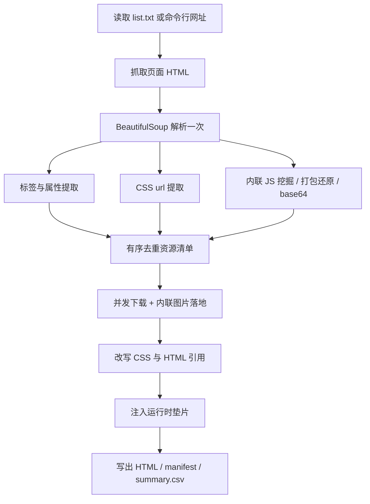

# html_Ripper
简单来说，这是为了更方便的批量保存网页以本地离线浏览，且我有意将此工具尽可能简单使用。由于一开始面向的是漫画网站，所以可能更偏向对图像的爬取

（请原谅我的技术力之低，不得不使用了AI工具）

# 批量网页元素下载器 · Batch Web Asset Downloader

> 单文件 Python 脚本 · **纯 pip 依赖** · **零浏览器** · 批量抓取 + 离线本地化
>
> 版本 `v1.1` ｜ 适用 Python `3.10 – 3.13` ｜ 平台 Windows / macOS / Linux

将一批网址的 HTML 与全部页面元素保存至本地，并把引用改写为本地相对路径，实现**断网可读**。
全程不安装、不驱动、不修改任何浏览器，不执行任何远程代码。

---

## 目录

- [1. 功能特性](#1-功能特性)
- [2. 环境依赖](#2-环境依赖)
- [3. 快速开始](#3-快速开始)
- [4. 命令行参数](#4-命令行参数)
- [5. 输出文件结构](#5-输出文件结构)
- [6. 工作原理](#6-工作原理)
- [7. 离线阅读与故障排查](#7-离线阅读与故障排查)
- [8. 已知限制](#8-已知限制)
- [9. 性能与并发建议](#9-性能与并发建议)
- [10. 安全与合规](#10-安全与合规)
- [11. 变更记录](#11-变更记录)
- [12. 验证状态与免责声明](#12-验证状态与免责声明)

---

## 1. 功能特性

| 能力 | 说明 |
| --- | --- |
| 批量抓取 | 从 `list.txt` 或命令行读取多个网址，支持并发与队列两种模式 |
| 常规元素 | `img` / `source` / `audio` / `video`，含 `data-src`、`data-original`、`data-lazy-src`、`srcset` 全候选、`poster` |
| 样式与脚本 | 外链 CSS / JS、站点图标；CSS 内部 `url(...)` 引用的背景图与字体 |
| 内联资源 | `<style>` 与 `style` 属性中的 `url(...)`；`data:image/...;base64` 内联图片落地为独立文件 |
| **JS 资源挖掘** | 内联脚本中的图片数组、JSON、转义斜杠、图床前缀变量拼接、base64 字符串，以及 `eval(function(p,a,c,k,e,d){…})` 打包代码的**纯 Python 还原** |
| **离线本地化** | HTML / CSS 引用改写为本地相对路径，并注入运行时垫片拦截 JS 动态生成的地址 |
| 网络稳健性 | Chrome TLS/HTTP2 指纹伪装、线程局部会话复用、`Referer` 防盗链、指数退避重试、全局并发限流 |
| 断点续跑 | 页面级跳过 + 资源清单一致时的单文件级续传 |
| 归档追溯 | 每页保留原始网页备份、有序资源清单、`URL → 本地文件` 映射表；全局 `summary.csv` |
| 编码兼容 | 响应头与 `<meta>` 嗅探，回退 `utf-8 / gb18030 / big5` |

---

## 2. 环境依赖

### 2.1 Python 包

| 包 | 必需性 | 用途 | 备注 |
| --- | :---: | --- | --- |
| `requests` | 必需 | 兜底 HTTP 通道 | 纯 Python |
| `beautifulsoup4` | 必需 | HTML 解析与改写 | 纯 Python |
| `tqdm` | 必需 | 进度条 | 纯 Python |
| `lxml` | 建议 | 高速解析器 | 缺失时自动回退 `html.parser` |
| `curl_cffi` | 建议 | Chrome 指纹 + 连接复用 | wheel 为 `cp310-abi3` 稳定 ABI，可直接安装于 3.13；缺失时自动回退 `requests` |

其余全部使用标准库：`argparse` `base64` `csv` `glob` `hashlib` `json` `os` `random` `re` `threading` `time` `concurrent.futures` `urllib.parse`。

### 2.2 安装

```bash
python -m pip install -U pip
python -m pip install -U requests beautifulsoup4 tqdm lxml curl_cffi
```

> **提示**：Windows 多版本共存时，请将 `python` 替换为 `py -3.13`。

### 2.3 明确不需要

`playwright`、`selenium`、`DrissionPage`、`PyExecJS`、Node.js，以及任何浏览器内核下载命令。

> **注意**：本脚本**不支持**在浏览器内的 Python（Pyodide / WebAssembly）中运行——该环境的网络请求受 CORS 限制，与依赖无关。

---

## 3. 快速开始

**第 1 步** — 将脚本与 `list.txt` 置于同一目录。`list.txt` 一行一个网址，支持 `#` 注释与行尾备注：

```text
# comic
https://example.com/comic/chapter/xxx/0_0.html
https://example.com/comic/chapter/xxx/0_1.html   第二话
# 下面这行暂不下载
# https://example.com/comic/chapter/xxx/0_2.html
```

**第 2 步** — 执行：

```bash
python download_elements.py
```

**第 3 步** — 查看 `downloads/summary.csv` 核对结果，双击 `downloads/0_0.html` 离线阅读。

> **建议**：首次使用请先小批量验证，确认无误后再批量执行。
>
> ```bash
> python download_elements.py URL1 URL2 --pages 1
> ```

---

## 4. 命令行参数

```text
python download_elements.py [列表文件或网址 ...] [选项]
```

| 选项 | 默认值 | 说明 |
| --- | --- | --- |
| `inputs` | 无 | 列表文件路径或若干网址；留空则自动查找同目录 `list.txt`，仍无则进入交互式粘贴 |
| `--out DIR` | `downloads` | 输出根目录，HTML 平铺于此 |
| `--assets-dir NAME` | `elements` | 素材总目录名 |
| `--pages N` | `3` | 同时处理的网页数；设为 `1` 即队列串行 |
| `--files N` | `6` | 单页内资源并发数 |
| `--limit N` | `12` | 全局并发请求上限（防封关键） |
| `--impersonate NAME` | `chrome` | `curl_cffi` 指纹档位，如 `chrome124`、`chrome131` |
| `--max-mb N` | `64` | 单文件体积上限（MB），`0` 表示不限 |
| `--no-skip` | 关闭 | 忽略已完成记录，强制重新下载 |
| `--no-localize` | 关闭 | 只下载资源，不改写 HTML |

### 常用示例

```bash
# 读取同目录 list.txt
python download_elements.py

# 指定列表文件
python download_elements.py mylist.txt

# 直接传入多个网址
python download_elements.py URL1 URL2 URL3

# 保守模式：站点防护严格时使用
python download_elements.py --pages 1 --limit 4

# 指定输出位置与指纹档位
python download_elements.py --out D:\dl --impersonate chrome124

# 全部重下 / 仅下载不改写
python download_elements.py --no-skip
python download_elements.py --no-localize
```

---

## 5. 输出文件结构

```text
工作目录/
├─ download_elements.py        主程序
├─ list.txt                    网址清单
├─ README.md                   本文档
└─ downloads/                  输出根目录
   ├─ 0_0.html                 主体 HTML（原名，已本地化，可双击离线阅读）
   ├─ 0_1.html
   ├─ summary.csv              总览表（UTF-8 BOM，可直接用 Excel 打开）
   └─ elements/                素材总目录，按页隔离
      ├─ 0_0/
      │  ├─ 0001_01.jpg        素材文件，四位序号保持页面顺序
      │  ├─ 0002_02.jpg
      │  ├─ 0003_main.css      内部 url() 已改写为同目录文件名
      │  ├─ 0004_reader.js
      │  ├─ _page_raw.html     原始网页备份（未做任何改写）
      │  ├─ _resources.txt     本页提取到的全部资源地址（有序）
      │  └─ _manifest.json     下载记录 + URL→本地文件映射
      └─ 0_1/
```

### 命名规则

| 对象 | 规则 |
| --- | --- |
| HTML | 直接使用网页原文件名，平铺于输出根目录 |
| 素材目录 | 与 HTML 主名严格一致，一一对应，**绝不合并** |
| 同名处理 | 同一批次内不同网址若撞名，后者追加 `_2`、`_3` 以防覆盖 |
| 素材文件 | `四位序号_原始名.扩展名`；扩展名缺失时按 `Content-Type` 补全 |
| 编号顺序 | 内联 base64 图片占 `1…N`，网络资源自 `N+1` 起，不重号 |

### `summary.csv` 字段

| 字段 | 含义 |
| --- | --- |
| `url` | 原始网址 |
| `html` | 落地的 HTML 文件名 |
| `assets` | 对应素材目录 |
| `status` | `done` / `skipped` / `failed` |
| `ok` / `total` | 成功文件数 / 应下载总数 |
| `error` | 失败原因（异常类型与信息） |

---

## 6. 工作原理



### 五个阶段

| 阶段 | 关键动作 |
| --- | --- |
| **① 抓取** | 优先以 `curl_cffi` 模拟 Chrome 的 TLS/HTTP2 指纹，失败自动降级 `requests`；线程局部会话复用连接；携带 `Referer`；`429/5xx` 指数退避重试；全局信号量限流；编码嗅探 |
| **② 提取** | 常规标签属性 + `srcset` 全候选 + `poster` + 图标；`<style>` 与 `style` 属性中的 `url(...)`；内联 JS 的绝对地址、转义斜杠、协议/根相对路径、图床前缀拼接、base64 解码、`p.a.c.k.e.r` 打包还原；按出现顺序去重以保页码 |
| **③ 下载** | 网页级线程池 × 资源级线程池；外链 CSS 先行解析补全资源；内联图片直接落地；成功项记入 `URL → 本地文件名` 映射 |
| **④ 本地化** | 清理 `<base>`、`integrity`/`crossorigin`/`nonce`、CSP `meta`；改写属性、`srcset`、`style`、`<style>`、内联 JS；改写已下载 CSS 内部 `url(...)`；注入运行时垫片 |
| **⑤ 归档** | 写出 `_page_raw.html`、`_resources.txt`、`_manifest.json` 与全局 `summary.csv` |

### 本地化的三重保障

1. **静态改写** — 直接把源码中的地址替换为 `elements/<同名>/xxxx_文件名`。
2. **CSS 改写** — 已下载 CSS 内部的 `url(...)` 改为同目录文件名（严格 UTF-8 解码，非 UTF-8 文件跳过而非损坏）。
3. **运行时垫片** — 在 `<head>` 最前注入无依赖原生 JS，按「完整地址 / 原始文件名」双表映射，拦截 `setAttribute`、`img.src`、`fetch`、`XHR` 与 DOM 变动，并处理运行时注入的 `<style>` 文本。**这是漫画类站点能离线阅读的关键。**

### 续跑机制

| 层级 | 触发条件 | 行为 |
| --- | --- | --- |
| 页面级 | HTML 与 `_manifest.json` 同时存在 | 整页跳过（`--no-skip` 可关闭） |
| 文件级 | `_resources.txt` 与本次提取清单**完全一致** | 按序号跳过已存在且非空的文件 |

---

## 7. 离线阅读与故障排查

<details>
<summary><b>Q1. 双击 HTML 后图片不显示？</b></summary>

按序检查：

1. `elements/<名>/_resources.txt` 是否列出了图片地址；
2. `_manifest.json` 的 `mapping` 中这些地址是否下载成功（**失败项不会被改写**）；
3. 页面是否依赖 XHR/fetch 读取本地 JSON —— Chrome 在 `file://` 下禁止此行为。

解决方式（仅启动临时本地服务，不改动浏览器配置）：

```bash
cd downloads
python -m http.server 8000
# 浏览器访问 http://localhost:8000/0_0.html
```

</details>

<details>
<summary><b>Q2. 提示「未发现图片地址」？</b></summary>

打开 `_page_raw.html`，搜索 `.jpg` / `.webp` / `chapterImages` / `imgHost` 等关键字，确认地址的存放形式。
若地址由 JS **按页码动态计算**生成而非出现在源码中，静态提取无法覆盖，需要针对性补充解析规则。

</details>

<details>
<summary><b>Q3. 大量 403 / 超时？</b></summary>

- 降低并发：`--pages 1 --limit 4`
- 确认已安装 `curl_cffi`（首行日志会显示当前通道）
- 尝试更换指纹档位：`--impersonate chrome124`
- 图床通常校验 `Referer`，脚本已自动携带页面地址

</details>

<details>
<summary><b>Q4. 中文乱码？</b></summary>

脚本按响应头与 `<meta>` 嗅探编码，并回退 `utf-8 / gb18030 / big5`。若仍异常，可强制指定编码后重跑该页。

</details>

<details>
<summary><b>Q5. Windows 提示路径过长？</b></summary>

将输出目录设为短路径，例如 `--out D:\dl`。脚本已将目录名截断至 70 字符、文件名至 50 字符。

</details>

<details>
<summary><b>Q6. 想保留原始网页而不改写？</b></summary>

加 `--no-localize`。任何情况下 `_page_raw.html` 都是未改写的原件，可随时回退。

</details>

---

## 8. 已知限制

| # | 限制 | 影响 / 对策 |
| --- | --- | --- |
| 1 | 无法通过需要完整浏览器执行的 JS 挑战（如 Cloudflare） | 纯 HTTP 库的固有边界 |
| 2 | 图片地址若在运行时由算法计算生成 | 提取与映射均会落空，需定制解析 |
| 3 | 章节间导航链接仍指向远程站点 | 未做跨页链接本地化 |
| 4 | 素材文件名带序号前缀 | 若站点 JS 依赖原始文件名解析页码，可能需去掉前缀 |
| 5 | Chrome `file://` 禁止 XHR/fetch 读本地文件 | 改用 `python -m http.server` |
| 6 | 非 UTF-8 编码的 CSS 跳过本地化 | 保护文件不被损坏，其内部引用仍指向远程 |
| 7 | 文件级续传需资源清单完全一致 | 页面结构变化时退化为整页重下 |

---

## 9. 性能与并发建议

| 场景 | 推荐参数 |
| --- | --- |
| 常规批量（默认） | `--pages 3 --files 6 --limit 12` |
| 站点防护严格 / 出现 403 | `--pages 1 --limit 4` |
| 大体积媒体较多 | `--files 3 --max-mb 32` |
| 网络不稳、频繁超时 | `--pages 1 --files 3` |

> **注意**：`--limit` 是全局在途请求上限，也是防止触发站点封禁的关键。**请勿为追求速度而放大。**
>
> 会话复用（连接保持 / HTTP2 多路复用）已默认启用，是本版最主要的提速来源。

---

## 10. 安全与合规

- 本工具仅用于**个人离线阅读与技术研究**。请遵守目标站点的服务条款与 `robots` 规则，尊重著作权，**请勿再分发下载内容**。
- Python 侧**不执行任何远程代码**：打包 JS 的还原为纯字符串运算，无 `eval`。
- 但打开本地 HTML **会执行站点原有 JavaScript**。阅读不可信站点时，建议断网，或使用独立的浏览器配置文件。
- 文件名经 `[^\w.\-]` 白名单过滤，**不存在路径穿越**；TLS 证书校验保持开启；单文件体积上限默认 64 MB。

---

## 11. 变更记录

### v1.1

| 编号 | 变更 |
| --- | --- |
| P1 | 线程局部会话复用（连接保持 / HTTP2）；`429` 与 `5xx` 指数退避；指纹档位一次性确定 |
| P2 | 本地化前移除 `<base>`、`integrity` / `crossorigin` / `nonce`、CSP `meta` |
| P3 | 图床前缀变量按「是否为已下载地址前缀」精确改写；裸文件名改写与之联动 |
| P4 | CSS 回写前严格 UTF-8 解码，非 UTF-8 文件跳过而非损坏 |
| P5 | `srcset` 全候选、`poster`、`link rel=icon` 一并收集 |
| P6 | 资源清单一致时启用单文件续传（`glob` 路径已转义） |
| 附加 | 垫片处理运行时 `<style>` 文本；编号不再重号；全页仅解析一次；新增 `--max-mb` 与 `--impersonate`；base64 递归深度上限 |

### v1.0

首个可用版本：批量抓取、元素下载、HTML 平铺 + 素材隔离、基础本地化。

---

## 12. 验证状态与免责声明

**验证状态**

| 模块 | 状态 |
| --- | --- |
| 打包 JS 还原、内联 JS 图片挖掘、多线程下载链路 | 已在本地构造站点端到端实测通过 |
| 本地化改写、运行时垫片、批量调度 | 以逐行静态审查为主，**建议先小批量试跑验证** |

**免责声明**

本软件按「现状」提供，不对抓取结果完整性、目标站点可用性或由此产生的任何后果作出担保。使用者应自行确认其使用行为符合当地法律法规与目标站点条款。
